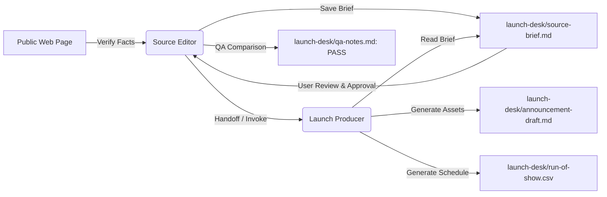

# Two-Bot Launch Relay (Challenge 7)

A multi-agent collaboration workflow demonstrating an automated **Two-Bot Relay** between two specialist AI agents (`Source Editor` and `Launch Producer`) sharing a synchronized workspace folder (`launch-desk/`).

---

## 🎯 Objective & Architecture

This project completes **CHALLENGE 7: Run a Two-Bot Launch Relay** for **Global Hack Week: Hacktoberfest** (Major League Hacking).

### The Core Principle: Single Responsibility
1. **Source Editor**:
   - **Role**: Fact verifier, brief creator, QA auditor.
   - **Responsibility**: Scrapes/verifies public pages, captures constraints, maintains source links, marks missing facts as `Unknown`, and audits deliverables.
2. **Launch Producer**:
   - **Role**: Production asset creator.
   - **Responsibility**: Reads the approved brief from `launch-desk/` and outputs a 120–180 word announcement and a structured `run-of-show.csv` (≥ 5 rows).
3. **Automated Handoff**:
   - The user conducts the entire relay in a single conversation with `Source Editor`.
   - Once approved, `Source Editor` invokes `Launch Producer` autonomously via tool/subagent delegation.



---

## 📁 Repository Structure

```text
.
├── README.md                          # Project documentation and execution instructions
└── launch-desk/                       # Shared workspace for both bots
    ├── source-brief.md                # Verified brief with constraints and facts
    ├── source-brief.txt               # Plain-text fallback copy
    ├── announcement-draft.md          # 160-word announcement (strictly 120–180 words)
    ├── run-of-show.csv                # 7-row schedule (Time, Owner, Action, Status)
    └── qa-notes.md                    # QA verification report (Status: Pass)
```

---

## 🤖 Bot Configurations

### 1. Source Editor
* **Bot Name**: `Source Editor`
* **Instructions / System Prompt**:
  ```text
  Verify facts, preserve source links, use Unknown for missing information, and save work as launch-desk/source-brief.md. Ask before contacting anyone or publishing.
  ```

### 2. Launch Producer
* **Bot Name**: `Launch Producer`
* **Instructions / System Prompt**:
  ```text
  Read an approved brief and create a 120- to 180-word launch-desk/announcement-draft.md plus launch-desk/run-of-show.csv with at least five rows. The run of show must use the columns Time, Owner, Action, and Status. Use only the approved brief. Ask before sending, publishing, purchasing, or changing an external system.
  ```

---

## 🚀 Execution Steps (Grok Bot & Cloud Workspace)

### Step 1: Initialize Brief Generation
Start a chat with **Source Editor** and run:
```text
Build the brief from https://hacktoberfest.com. Use these announcement constraints: Audience: Open-source contributors, student developers, and AI builders; Tone: Inspiring, welcoming, and high-energy; Call to action: Sign in to My Hacktoberfest with your MyMLH account, find your local Fest or join DEV Challenges online, and start building with open-source AI today! Verify facts, preserve source links, use Unknown for missing information, save the brief as launch-desk/source-brief.md, and stop for my approval before handing it to Launch Producer. Do not contact anyone or publish anything.
```

### Step 2: Approve and Handoff
Review `launch-desk/source-brief.md` (or `launch-desk/source-brief.txt`). In the **same chat**, send:
```text
I approve the brief. Please invoke Launch Producer and bring the result back to this conversation.
```
*Launch Producer will generate `launch-desk/announcement-draft.md` and `launch-desk/run-of-show.csv`.*

### Step 3: Run Automated QA
Prompt **Source Editor** in the same chat:
```text
Compare launch-desk/announcement-draft.md and launch-desk/run-of-show.csv with the approved brief in launch-desk/source-brief.md. Save launch-desk/qa-notes.md with either Pass or a short list of fixes.
```
*Source Editor writes `launch-desk/qa-notes.md` with **Pass**.*

---

## 📋 Deliverable Verification Summary

| File | Target Rule | Actual Metric | Result |
| :--- | :--- | :--- | :---: |
| [`source-brief.md`](launch-desk/source-brief.md) | Accurate facts & source links | Sourced from `hacktoberfest.com` | ✅ Pass |
| [`announcement-draft.md`](launch-desk/announcement-draft.md) | Word count: 120–180 words | **160 words** | ✅ Pass |
| [`run-of-show.csv`](launch-desk/run-of-show.csv) | Headers: `Time, Owner, Action, Status` | Schema matches; **7 rows** | ✅ Pass |
| [`qa-notes.md`](launch-desk/qa-notes.md) | Explicit Pass or fix list | Status: **Pass** | ✅ Pass |

---

## 📤 Submission Artifacts Checklist

1. **Bot-to-Bot Handoff**: Screenshot of the single chat thread showing `Source Editor` invoking `Launch Producer` and receiving the deliverables.
2. **Completed Files**: Full text or screenshots of `announcement-draft.md` and `run-of-show.csv`.
3. **Folder & QA Verification**: Screenshot of the `launch-desk/` directory alongside `qa-notes.md` showing **Pass**.
